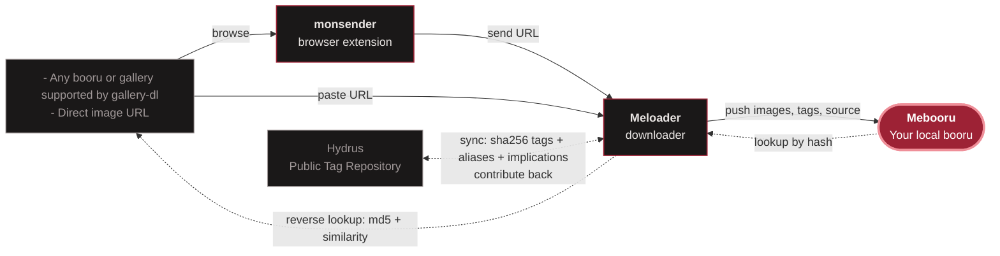

<p align="center">
  
</p>

# Mebooru

Your own private, lightweight and fast booru: a tag-based image gallery, in the style of Danbooru, for your files.

Mebooru is a fork of [Monbooru](https://github.com/monbooru/monbooru), based on the audited v1.24.0 release. It preserves Monbooru's lightweight, local-first architecture while developing a distinct interface, workflow, privacy model, and optional AI-assisted organization features.

For project direction, chapter roadmap, current milestone and development decisions, start with [MEBOORU.md](MEBOORU.md), our single project north star. The [documentation index](docs/README.md) points to technical and historical evidence. Development uses [milestone-level draft PRs and final acceptance](MEBOORU.md#development-workflow), not a full matrix for every intermediate commit.

Development status: Meloader's source is now consolidated under [`meloader/`](meloader/) in the integration history. The accepted II.6.4a private-worker architecture is a diagnostic foundation, not an enabled production acquisition path; ordinary library/acquisition behavior remains on existing compatible launch and API paths until migration acceptance. See the [technical map](docs/project/managed-worker.md) and [acceptance record](docs/validation/worker-ownership-runtime-2026-11-26.md).

Designed for organizing your local media collection: images, videos, animated GIFs and manga archives. Tag it by hand or auto-tag it locally with ONNX models (WD14, JoyTag...), then search it by tag. Generation metadata from AI image tools (A1111/Forge, ComfyUI) is read too. Mebooru itself never touches the internet; online features (downloading from boorus, reverse image lookup) live in [Meloader](https://github.com/jwebb7847-ui/meloader), the forked companion (originally Monloader).

**[Upstream documentation](https://monbooru.github.io/mondocs/)** · **[Install](#install)** · **[Upstream Monbooru](https://github.com/monbooru/monbooru)** · **[Changelog](CHANGELOG.md)**


## Features

### Library

- **Formats**: JPEG, PNG, WebP, AVIF, JPEG XL, GIF, MP4 and WebM, plus CBZ/ZIP archives read as a single item in a built-in manga reader
- **File watcher** that picks up new, moved and deleted files within seconds; browser upload; SHA-256 deduplication
- **Inbox**: new images wait in the inbox until you've reviewed and tagged them
- **Multiple galleries** in one instance, each with its own folders and database; per-gallery export and import
- **Import** from supported booru applications

### Tags

- **Tag management**: merge duplicates, aliases, implications, custom categories
- **Rating tags** (general / sensitive / questionable / explicit), with independent footer rating ceilings and a persistent **show/hide unrated** toggle. A virtual Unrated row supports searching for unrated items; local scans do not infer content ratings.
- **Local auto-tagging** with ONNX models (WD14 SwinV2, animetimm EVA02, JoyTag, Camie v2, PixAI, or any compatible model), on CPU or GPU

### Browse and search

- **Gallery** with folder tree, favorites, collections, related-image suggestions, animated previews on hover, and a fullscreen slideshow of a search or a selection
- **Search** with wildcards, OR, exclusions, saved searches, and filters on folder, date, size, dimensions, category, generation settings, and more
- **Batch operations** on a selection or a whole search: add or remove tags, move, delete, auto-tag, set collection or source, and more
- **Keyboard-driven**: shortcuts on every page, from grid navigation to batch actions; press `?` in the app for the full list

### Image details

- **Sources and provenance**: several sources per image, artist commentary, note boxes, and your own notes
- **Image relations**: duplicates, alternates, version chains, derivatives; near-duplicate detection with a side-by-side review and cleanup tools
- **AI generation metadata** from A1111/Forge and ComfyUI: prompts, models, seeds, full workflows

### Access and integrations

- **Optional password login**
- **REST API** with scoped tokens, an OpenAPI spec, and built-in docs
- **Plugins and themes**: drop one in the plugins or themes folder and turn it on in Settings; Mebooru launches and supervises plugins for you
- **Downloads and reverse lookup** through the optional [Meloader](#related-applications) companion

## Install

Mebooru is developed on Apple Silicon macOS. The [native verification workflow](https://github.com/jwebb7847-ui/mebooru/actions/workflows/native.yml) builds and runs Mebooru and Meloader on Linux (x86_64, arm64), Windows (x86_64), and macOS (Intel, Apple Silicon). Once started, Mebooru is available at `http://localhost:8455`.

Build from the `mebooru-foundation` branch with `make build-all` for both executables, or `go build -o mebooru ./cmd/monbooru` for the library alone. The two application modules retain independent dependency graphs and use a common `shared/` module; `make test-all`, `make test-race-all` and `make vet-all` cover all three. The command directory and default config name retain their historical spelling.

### Open Mebooru with Meloader

For the macOS app, build from the Mebooru checkout with
`sh packaging/build-macos-app.sh`, then open
`dist/Mebooru.app` in Finder. The app starts its bundled Meloader in the
background. Both use the existing per-user configs in
`~/Library/Application Support` unless you supply an explicit config.
Eligible fresh standard profiles automatically pair the bundled companion. Existing, paused, revoked or partially reset profiles retain their decisions. If manual recovery is needed, request pairing from [Meloader Settings](http://127.0.0.1:8456/settings#pairing) and approve it in **Mebooru → Settings → Plugins**. Exit the app to stop the process it launched; if a web Quit control is missing, identify the listening process before using a terminal TERM signal. See the [Mac runbook](https://github.com/jwebb7847-ui/meloader/blob/main/docs/validation/local-audit.md).

The local build uses an ad-hoc signature. For downloads, a public macOS
release needs signing and notarization. The bundle includes both app
binaries. Meloader uses your configured gallery-dl, or a gallery-dl on PATH
including standard Homebrew locations. The core bundle uses the browser UI
and has no bundled ONNX Runtime or FFmpeg.

Video thumbnails use FFmpeg. Animated previews need a build with animated
WebP encoding support. On macOS, Mebooru also checks the standard Homebrew
binary directories when launched from Finder. To install and link a build
with WebP support using Homebrew:

```sh
brew install ffmpeg-full && brew link --force ffmpeg-full
```

Restart Mebooru after installing FFmpeg. Use **Settings → Maintenance →
Rebuild thumbnails** to recover previews for existing videos. Choose
**Static thumbnails** or **Animated WebP on hover** under **Settings →
General → Video thumbnails**.

On macOS and Linux, build the imported companion from `meloader/` (or run `make build-all` from the repository root to build both). Standalone launches still use explicit pairing. To start
your existing Meloader configuration when Mebooru opens, set these paths
in Mebooru's config:

```toml
[desktop]
meloader_binary = "/absolute/path/to/meloader"
meloader_config = "/absolute/path/to/monloader.toml"
```

Launch Mebooru with `-desktop=true`. It opens only the Mebooru interface and
stops the companion it launched when you quit the Mebooru process. Keep any
environment overrides your Meloader setup needs, including the gallery-dl
and archive paths. For a single run, `-meloader` and `-meloader-config`
specify the same paths on the command line.

Use **Loader → Queue** to submit imports into the active gallery through
the paired API. On a direct local HTTP connection, Watches, PTR, Advanced
queue, and Meloader settings use the paired loopback address when **Settings
→ Plugins → Web URL** is blank. Set the Web URL explicitly for other
deployments. Set Meloader’s `[monbooru].web_url` to the origin you use in your
browser to allow these views to open inside Mebooru.

When Mebooru launches the companion, quitting Mebooru stops it as well. Use
the same companion options when restarting Mebooru, or start Meloader in its
own terminal with the same configuration. **Settings → Plugins → Save
addresses** updates the connection settings for the existing companion.

New environment settings can use `MEBOORU_`, such as `MEBOORU_SERVER_BIND_ADDRESS` and `MEBOORU_MELOADER_API_URL`. Existing `MONBOORU_` variables still work. When both are set to valid values, the new name takes precedence.

### Docker

The inherited [Compose example](docker/docker-compose.yml) and Quadlet files pull upstream images by default; they are historical deployment examples, not accepted Mebooru configurations. Build both local images from the consolidated repository root with `docker build -f docker/Dockerfile -t mebooru-local .` and `docker build -f meloader/docker/Dockerfile -t meloader-local .`. CI verifies the build stages only; complete image runtime, GPU, container network isolation and deployment acceptance remain deferred. Do not run the upstream examples unchanged expecting this fork, or use real media/config paths in an unverified deployment. See [packaging status](packaging/README.md).

### Current installation status

Mebooru does not yet publish its own release binaries. The current development
branch has been launched and exercised from Finder on Apple Silicon macOS with Go 1.27.x. PR #11 also passed native automated Linux (x64/ARM64), Windows, and both macOS architectures; those are **not** substitutes for Windows/Linux end-user installer tests.

Upstream [Monbooru releases](https://github.com/monbooru/monbooru/releases)
remain available for Linux and Windows, but those packages contain stock
Monbooru rather than Mebooru.

### Next steps

[MEBOORU.md](MEBOORU.md) records the latest accepted milestone, active roadmap and outstanding work. The [handoff](docs/project/handoff.md) preserves earlier acceptance context; the former backlog is a compatibility pointer. The inherited [Monbooru documentation](https://monbooru.github.io/mondocs/) remains useful for features retained from upstream.

## Warning

> **Intended for local network use.** This project is not designed for direct exposure to the public internet.

## Technical overview

Mebooru is a single self-contained Go binary, web assets embedded, with seven direct dependencies. Each gallery is one SQLite file: no database server, no cache layer, nothing else to run. Your images stay ordinary files and folders; the database and thumbnails live in a separate data directory, so backing up means copying that directory, and removing Mebooru leaves your images where they were. The UI is server-rendered with htmx, with no JS framework and no frontend build step.

The heavy features stay out of the main process. Auto-tagging is off until you install a model from **Settings → Auto-Tagger**, and runs in a separate worker that unloads itself when idle. ffmpeg is optional, needed only for video, animated previews, AVIF and JPEG XL.

## Related applications

Mebooru works offline. These optional applications add online features:



- **Mebooru**: this application; organizes, tags, and serves your collection.
- **[Meloader](https://github.com/jwebb7847-ui/meloader)**: downloader. Fetches files and per-post metadata (via gallery-dl) from supported boorus and galleries and pushes them into a Mebooru gallery over the REST API. It also answers Mebooru's reverse lookups against boorus, IQDB, SauceNAO and the Hydrus Public Tag Repository, to backfill tags and sources; when a matched post has a better file than your local copy, one click replaces it in place. The PTR connection can also pull tag aliases and implications into your catalog.
- **[monsender](https://github.com/monbooru/monsender)**: browser extension; sends the URL of the page you're browsing to Meloader.
- **[monbooru-plugins](https://github.com/monbooru/monbooru-plugins)**: community registry of plugins, themes and extra taggers.

## Contributing

Bug reports, ideas and pull requests are welcome.

See [CONTRIBUTING](CONTRIBUTING.md) for more information.

Mebooru bugs, feature requests, and pull requests belong in this repository.

For inherited Monbooru behavior, the upstream documentation and public
Discussions remain useful references.

## License

[AGPL-3.0](LICENSE).

## Acknowledgements

Mebooru is built on Monbooru v1.24.0 and retains its AGPL-3.0 license, repository history, and contributor attribution. The upstream ecosystem also includes [monloader](https://github.com/monbooru/monloader), [monsender](https://github.com/monbooru/monsender), [mondocs](https://github.com/monbooru/mondocs), and [monbooru-plugins](https://github.com/monbooru/monbooru-plugins).

Thanks to [@gary-host-laptop](https://github.com/gary-host-laptop) and [@CeareDelafont](https://github.com/CeareDelafont) for sustained contributions over time. Everyone credited in a release is listed in [CONTRIBUTORS](CONTRIBUTORS.md).

Upstream Monbooru credits tamaki for the original mon-chan visuals.

Thanks to [Danbooru](https://danbooru.donmai.us/) for shaping the booru style, and to [Hydrus Network](https://hydrusnetwork.github.io/hydrus/) a precursor in personal image and tag management that inspired Monbooru, whose architecture Mebooru inherits.

This project is built on the work of others:

- [htmx](https://htmx.org/) powers the server-rendered UI.
- [SQLite](https://sqlite.org/), through the pure-Go [modernc.org/sqlite](https://gitlab.com/cznic/sqlite) driver, stores each gallery.
- [ONNX Runtime](https://onnxruntime.ai/), through [onnxruntime_go](https://github.com/yalue/onnxruntime_go), runs the auto-tagger. The supported models are the work of [SmilingWolf](https://huggingface.co/SmilingWolf) (WD SwinV2 v3), [animetimm](https://huggingface.co/animetimm) (EVA02), [fancyfeast](https://huggingface.co/fancyfeast) (JoyTag), [Camais03](https://huggingface.co/Camais03) (Camie Tagger v2), and [PixAI](https://huggingface.co/pixai-labs) (PixAI Tagger v1.0, in [noaione](https://huggingface.co/noaione)'s ONNX export).
- [ffmpeg](https://ffmpeg.org/) decodes video, AVIF and JPEG XL for thumbnails and hover previews; the bundled downloads carry a trimmed build of it from [ffmpeg-builds](https://github.com/monbooru/ffmpeg-builds), statically linked with [libwebp](https://chromium.googlesource.com/webm/libwebp), [dav1d](https://code.videolan.org/videolan/dav1d) and [libjxl](https://github.com/libjxl/libjxl).
- Meloader is mostly a wrapper for [gallery-dl](https://github.com/mikf/gallery-dl), which does the actual scraping. Reverse lookups by image similarity are answered by [IQDB](https://iqdb.org/) and [SauceNAO](https://saucenao.com/); md5 lookups by the boorus themselves. The PTR tag lookup syncs against the [Hydrus Public Tag Repository](https://hydrusnetwork.github.io/hydrus/PTR.html) (PTR) via [Hydrus Network](https://github.com/hydrusnetwork/hydrus)'s repository protocol; the tags, aliases, and implications it serves are the work of the hydrus community.
- monsender's in-page image detection uses code from [ushiro](https://github.com/gary-host-laptop/ushiro) by gary-host-laptop and [behind!](https://github.com/kubuzetto/behind) by kubuzetto, originally under MPL-2.0.
- The mondocs site is built with [Hugo](https://gohugo.io/).

The full Go dependency lists are in each repo's `go.mod`.

The sample images in the screenshots, here, in the companion repos, and in the documentation, were downloaded from Danbooru and are the work of their respective artists, who retain all rights. They appear only to demonstrate the app; the repositories' license doesn't apply to them.
