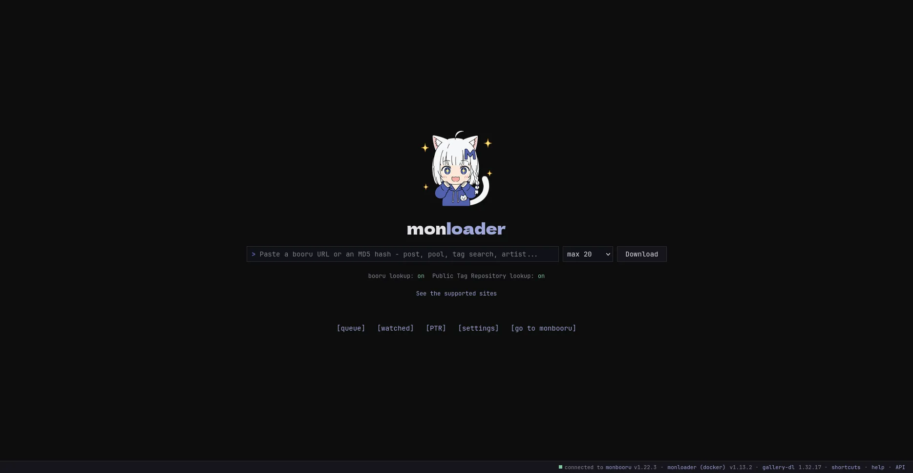
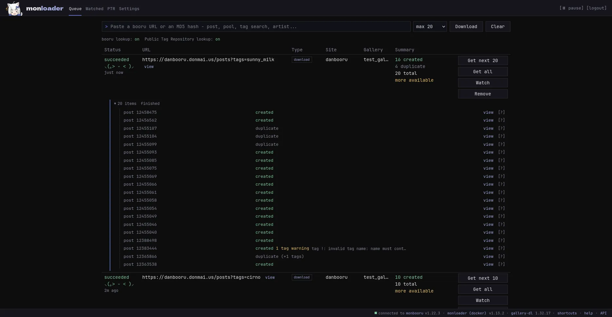
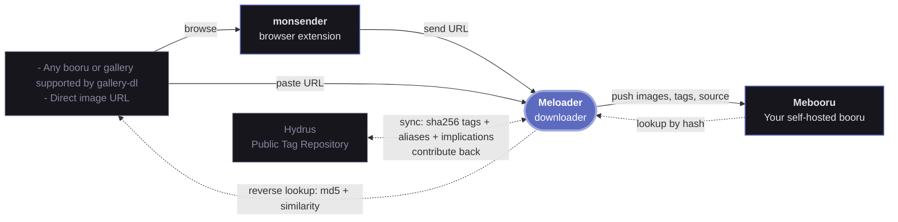

# Meloader

Meloader is the acquisition companion for [Mebooru](https://github.com/jwebb7847-ui/mebooru/tree/mebooru-foundation). It is a fork of upstream [Monloader](https://github.com/monbooru/monloader).

Paste a URL from a booru, a gallery, [any site gallery-dl supports](https://github.com/mikf/gallery-dl/blob/master/docs/supportedsites.md), or a direct image link: Meloader fetches the files with their tags, rating and source, and pushes them into a Mebooru gallery. For a file Mebooru already holds, it looks up tags by md5 or image similarity (IQDB, SauceNAO) on the boorus, or in an optional local copy of the [Hydrus Public Tag Repository](https://hydrusnetwork.github.io/hydrus/PTR.html).

Meloader never touches your files directly: everything goes through Mebooru's API. It can add images and tags and, for an upgrade Mebooru asks for, swap in a better file.

**[Current project north star](../MEBOORU.md)** · **[Development workflow](../MEBOORU.md#development-workflow)** · **[Historical roadmap](ROADMAP.md)** · **[Install](#install)** · **[Fork releases](https://github.com/jwebb7847-ui/meloader/releases)** · **[Changelog](CHANGELOG.md)**

For consolidated development, start with the [root north star](../MEBOORU.md). The [old handoff](docs/project/handoff.md), [roadmap](ROADMAP.md), and [local audit runbook](docs/validation/local-audit.md) preserve historical two-repository evidence, not current workflow.

<table>
  <tr>
    <td></td>
    <td></td>
  </tr>
</table>

## Features

- **Download** a booru post, pool, tag search or artist page, or a direct image link
- **Pools and manga**: a booru pool imports as an ordered collection; a manga or comic gallery becomes one `.cbz` for Mebooru's reader
- **Tags mapped to Mebooru**: tags by category (artist, character, copyright, meta...), rating and source, normalized across booru families
- **Optional strict blacklist verification** in Settings → Rules checks source metadata before requesting media on supported routes. [Scope and setup](docs/validation/blacklist-timing.md)
- **50+ site profiles** for boorus and manga/comic sites; every other gallery-dl site works through a generic fallback
- **Update gallery-dl** from the app, or roll it back, when a site fix lands, without waiting for a Meloader release
- **Queue** that shows whether each item was added, already in your library, skipped, or failed
- **Watched searches**: save a tag search or an artist page and Meloader checks it on a schedule, fetching only new posts
- **Reverse lookup**: exact md5 searches on the boorus, IQDB and SauceNAO similarity lookups for re-encoded copies, and offline sha256 lookups in an optional local copy of the Hydrus PTR (needs about 80 GB of disk)

## Related applications

Meloader is a companion downloader for Mebooru. It fetches images from the web and pushes them into your library:



- **[Mebooru](https://github.com/jwebb7847-ui/mebooru/tree/mebooru-foundation)**: self-hosted booru; organizes, tags, and serves your collection.
- **Meloader**: this application; fetches files and per-post metadata (via gallery-dl) and pushes them into a Mebooru gallery over the REST API; also answers Mebooru's reverse lookups (boorus, IQDB/SauceNAO, Hydrus PTR) and source refetches.
- **[monsender](https://github.com/monbooru/monsender)**: browser extension; sends the URL of the page you're browsing to Meloader.

## Install

Build from the `meloader/` directory of the consolidated Mebooru checkout with Go 1.27.x and an installed gallery-dl:

```bash
go build -o meloader ./cmd/monloader
./meloader -desktop=false -config ./monloader.toml
```

When updating, point `-config` at your existing Meloader configuration to keep its pairing, queue, and archive settings. The Finder-built Mebooru macOS app can start its bundled Meloader process, but a fresh profile **still requires manual Connect/Approve pairing**; secure auto-pairing of only the trusted bundled companion is planned, not shipped. The command directory and default config filename retain their historical spelling. Meloader opens at `http://127.0.0.1:8456` in the local setup. See the [paired Mac audit runbook](docs/validation/local-audit.md) for the full launch sequence.

### Strict blacklist / managed gallery-dl on macOS

For strict pre-download verification, open **Settings → Rules** and review the global/per-source blacklist; verify the active gallery-dl build in **Settings → Advanced**. The project's CI-pinned regression baseline remains **gallery-dl `1.32.19`** (see [pins.env](packaging/pins.env)), not necessarily the most recent upstream release. On a recent Mac, a managed install using system Python 3.9/LibreSSL emitted `urllib3 NotOpenSSLWarning` and caused the strict filter self-test to fail despite otherwise valid source metadata. Rebuilding that environment under Homebrew Python 3.13/OpenSSL restored transfer. See the [verified diagnostic](docs/validation/blacklist-timing.md#mac-managed-gallery-dl-ssl-warning-2026-11-24). Do **not** disable strict verification merely to bypass environment warnings.

### Connect to Mebooru

1. In Meloader's **Settings → Mebooru**, set the **API URL** and **Web URL**. For the local setup, both are `http://127.0.0.1:8455`.
2. Under **Pairing**, click **Connect to Mebooru** and approve the request in **Mebooru → Settings → Plugins**.
3. In Meloader, choose the **Default gallery** and save. Open **Loader** in Mebooru to submit an import.

New environment settings can use `MELOADER_`, such as `MELOADER_SERVER_BIND_ADDRESS` and `MELOADER_MEBOORU_WEB_URL`. Existing `MONLOADER_` variables still work. When both are set to valid values, the new name takes precedence. The `[monbooru]` TOML section is still the on-disk name for the Mebooru connection.

### Docker and upstream builds

The inherited [Compose example](docker/docker-compose.yml) and Quadlet file pull upstream Monloader and are historical deployment examples, not accepted fork configurations. Build from the consolidated repository root as shown below. Full runtime and network-boundary validation remain outstanding; do not point unverified containers at real data. The [upstream documentation](https://monbooru.github.io/mondocs/addons/monloader/index.html) and [upstream releases](https://github.com/monbooru/monloader/releases) refer to Monloader.

### Public Tag Repository

Set the index directory with `[ptr].data_path` or
`MONLOADER_PTR_DATA_PATH`, then restart Meloader. The web settings display the
configured directory.

PTR connections verify the TLS certificate and hostname using the system
trust store. For a repository with a private CA or self-signed certificate,
obtain the appropriate PEM certificate from the operator over a trusted
channel. Set `[ptr].tls_ca_file` or `MONLOADER_PTR_TLS_CA_FILE` and restart.
The certificate must be valid for the hostname in `[ptr].address`. HTTP is
allowed for literal loopback addresses.

## Warning

> **Intended for local network use.** Meloader's UI is not designed to be exposed to the public internet.

## License

[AGPL-3.0](LICENSE).

## Acknowledgements

See [monbooru's acknowledgements](https://github.com/monbooru/monbooru#acknowledgements).

## Consolidated source builds

Build this imported module from the Mebooru checkout; its shared module is at `../shared`. For its Docker image, run `docker build -f meloader/docker/Dockerfile -t meloader-local .` from the repository root. The original standalone Meloader repository and release/AUR metadata are historical fallback paths; new consolidated release packaging is deferred. See the root `MEBOORU.md`.
